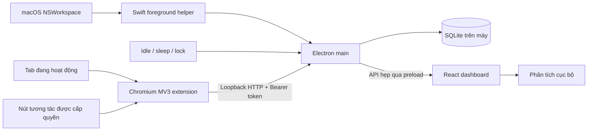

# Kiến trúc

Mạch có ba tiến trình/phần độc lập: giao diện React, tiến trình chính Electron và tiện ích Chromium. Database chỉ được truy cập qua Electron main. Mục tiêu là ghép danh tính ứng dụng với lịch sử tab đang được dùng, giữ việc thu thập và phân tích trên thiết bị.

## Thành phần

| Vị trí | Trách nhiệm |
| --- | --- |
| `src/` | Giao diện, bộ lọc, thống kê, chế độ demo và thao tác người dùng |
| `desktop/main.cjs` | Vòng đời ứng dụng, cửa sổ/thanh menu, IPC và khởi tạo collector |
| `desktop/preload.cjs` | Xuất `window.mach` qua context bridge |
| `desktop/helpers/foreground.swift` | Đọc tên/bundle ID ứng dụng đang ở phía trước bằng AppKit |
| `desktop/build-helper.cjs` | Biên dịch helper universal cho arm64 và x86_64 |
| `desktop/` | Database, local API, kiểm tra đầu vào, logic ghi nhận |
| `extension/` | Manifest V3, service worker, popup và social adapters |
| `tests/` | Kiểm thử các quy tắc thời lượng, xử lý dữ liệu và giao diện |
| `CONTRACT.md` | Giao ước dữ liệu và API dùng chung |

## Hợp đồng dữ liệu

Tất cả thời điểm dùng epoch milliseconds; thời lượng dùng giây. Mỗi `Activity` có `id` ổn định, `title`, `app`, `category`, `kind`, `startedAt`, `duration`; các trường URL, domain, action, excerpt và bookmark là tùy chọn.

Loại hoạt động:

- `app`: ứng dụng macOS đang ở phía trước.
- `page`: trang thuộc tab trình duyệt đang hoạt động.
- `interaction`: thao tác xã hội quan sát được, không dùng để cộng thêm thời gian sử dụng.

Phân loại `work`, `learn`, `social`, `life` là quy tắc heuristic dựa trên ứng dụng/tên miền. Một website có thể phục vụ nhiều mục đích; phân loại không phải kết luận về năng suất hoặc ý định của người dùng.

Một phiên trang được gửi cập nhật bằng **cùng ID** và thời lượng tích lũy. Database cập nhật bản ghi đó thay vì thêm một dòng mỗi heartbeat. Đây là điều kiện để không nhân số thời gian lên sau mỗi lần đồng bộ.

## Tránh đếm trùng và thời gian không hoạt động

Helper đọc danh tính ứng dụng; Electron dùng `powerMonitor` để xác định trạng thái idle/ngủ/khóa. Ngưỡng idle là 60 giây. Khi tiện ích đang kết nối, ứng dụng không cộng đồng thời phiên của đúng trình duyệt đã ghép nối ở cấp ứng dụng vào tổng thời lượng trang. Các trình duyệt khác vẫn có thể được đếm như ứng dụng thông thường.

Phía extension chỉ tính tab active trong cửa sổ trình duyệt có focus khi người dùng còn active. Mỗi request mang `X-Mach-Browser` với bundle ID Chrome, Edge hoặc Brave. Phía desktop kiểm tra bundle ID đó khớp với trình duyệt thực sự đang ở phía trước trước khi chấp nhận thời lượng. Header là thông tin từ client, còn khoảng thời gian được đối chứng bằng quan sát native. Các kiểm tra hai phía giúp giảm việc ghi nhận tab nền và thời gian máy ngủ.

Đây vẫn là phép đo theo mẫu và các sự kiện của hệ điều hành/trình duyệt. Đổi tab, rớt kết nối, đóng trình duyệt đột ngột hoặc service worker bị dừng có thể làm mất một phần thời gian ở ranh giới. Khi chưa có extension, ứng dụng vẫn có thể ghi tên trình duyệt ở cấp ứng dụng nhưng chưa có URL.

## Các ranh giới bảo mật

1. **Renderer → desktop:** API preload chỉ gồm các thao tác định danh (`getState`, `updateSettings`, `bookmark`, `deleteEvent`, `clearHistory`, `getPairingToken`, `openExternal`, `onStateChanged`). Không xuất `ipcRenderer`, Node hoặc shell tổng quát ra giao diện.
2. **Extension → desktop:** local API chỉ nghe tại `127.0.0.1:43821`; mọi endpoint kiểm tra token. Nguồn web tùy ý bị từ chối; origin extension phải đúng cấu trúc và được cố định cùng bundle ID trình duyệt sau lần xác thực đầu tiên. JSON giới hạn 128 KiB, kiểm tra trường và URL trước khi ghi.
3. **Website → extension:** nội dung trang là dữ liệu không đáng tin. Adapter chỉ đọc mục cần thiết và chỉ chạy khi có quyền site; không thực thi chuỗi từ trang. URL query/fragment bị bỏ trước khi lưu, chỉ giữ tham số `v` gồm đúng 11 ký tự `[A-Za-z0-9_-]` cho đường dẫn YouTube `/watch` để bảo toàn liên kết video. Desktop kiểm tra lại theo cùng quy tắc.
4. **Mở liên kết:** URL chỉ được mở qua API đã kiểm tra giao thức. Không dùng đường dẫn từ hoạt động làm lệnh hệ thống.
5. **Lưu trữ:** SQLite cục bộ và token không phải cơ chế bảo vệ trước phần mềm độc hại dưới cùng tài khoản. Xem [PRIVACY.md](PRIVACY.md).

Origin có định dạng extension hợp lệ không tự chứng minh extension đó đáng tin; token là yếu tố ghép nối ban đầu. Sau lần xác thực đầu tiên, ứng dụng gắn token với origin và bundle ID trình duyệt đó. Menu thanh trạng thái có **Ngắt ghép nối tiện ích…** để xoay token và thu hồi kết nối cũ. Khi phát triển tiếp, có thể bổ sung Keychain cho token và kiểm toán độc lập.

## Chế độ demo

Khi không có `window.mach`, giao diện sử dụng dữ liệu mẫu và lưu trạng thái demo riêng. Trình duyệt thông thường không có quyền đọc hoạt động toàn hệ thống. Dấu hiệu demo trong giao diện phải được giữ rõ ràng để người dùng không nhầm dữ liệu mẫu với việc thu thập đã diễn ra.

`npm run build:preview` dùng chế độ Vite `standalone` và `vite-plugin-singlefile` để nhúng JavaScript/CSS vào `dist-preview/index.html`. Có thể sao chép tệp này thành `Mach-preview.html` và mở bằng `file://` mà không chạy server. Đây là cùng giao diện React nhưng không có Electron preload, native helper hoặc database desktop. Build Electron vẫn dùng `npm run build` và thư mục `dist/` riêng.

## Mở rộng có chủ đích

- Adapter xã hội mới nên có kiểm thử DOM thực tế và chính sách loại trừ nội dung riêng tư trước khi thêm quyền host.
- Safari cần một adapter/extension khác và quy trình đóng gói của Apple; không thể chỉ đổi manifest Chrome.
- Nếu thêm đồng bộ hoặc AI từ xa, phải thiết kế lựa chọn tham gia và giải thích dữ liệu rời máy trước khi triển khai.
- Nếu thêm auto-start, auto-update hoặc quyền nhạy cảm hơn, cần tạo luồng giải thích và kiểm thử macOS riêng. Phiên bản này không mặc định cài launch agent hoặc trình cập nhật nền.

Yêu cầu Chromium có quyền host có thể thiếu Origin. Extension gửi thêm `X-Mach-Extension-Origin`; server chỉ dùng nó khi Origin thật vắng mặt, vẫn yêu cầu token và browser binding. Origin web, null hoặc không khớp luôn bị từ chối. Sau khi service worker khởi động lại hoặc khoảng gián đoạn hơn 20 giây, một đoạn hoạt động với UUID mới bắt đầu để bảo toàn phân bố thời gian.
